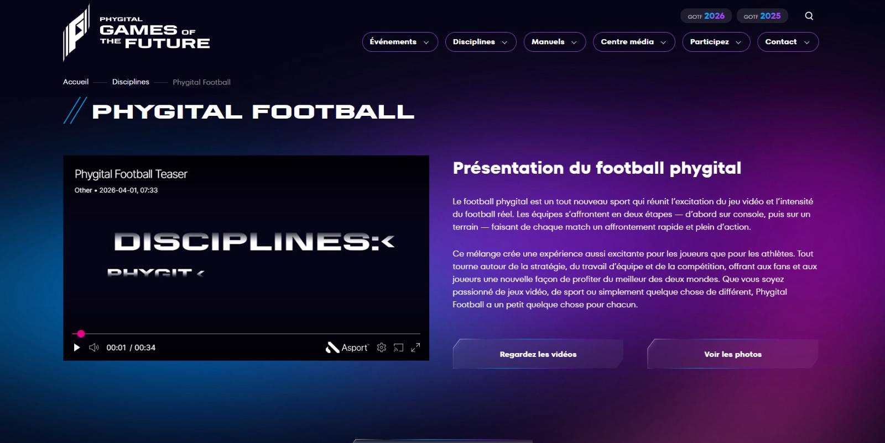

🏆 Projet PhygyTal Soccer - Documentation Technique & Spécifications
1. Vue d'Ensemble du Projet
PhygyTal Soccer est une plateforme web moderne dédiée à la gestion, la présentation et le suivi d'un tournoi de soccer novateur. Le concept repose sur une compétition hybride où les équipes s'affrontent sur deux tableaux : une manche physique sur un vrai terrain de soccer et une manche virtuelle (e-sport) sur console (ex: FIFA).
Le vainqueur d'une rencontre est déterminé par l'addition des scores des deux manches. En cas d'égalité, une séance de tirs au but permet de départager les équipes.

2. Choix Technologiques
Backend (API) : ASP.NET Core (C#) avec Entity Framework Core (Code-First) pour garantir robustesse et performances.

Frontend (Interface Utilisateur) : React.js pour l'espace public et le tableau de bord d'administration.

Hébergement / Plateforme : Antigrativity.

Inspiration UI/UX : MCP Stitch, avec une esthétique proche des portails événementiels (ex: GoFuture).

3. Structure du Tournoi (8 Équipes)
Le tournoi est conçu pour accueillir 8 équipes exclusives :

Phase de groupes : 2 groupes (Groupe A et Groupe B) composés de 4 équipes chacun.

Phase éliminatoire : Les deux meilleures équipes de chaque groupe accèdent aux demi-finales croisées.

Finales : La grande Finale pour déterminer le champion, et potentiellement un match pour la 3ème place.

4. Spécifications Fonctionnelles
4.1. Espace Administrateur (Gestion Globale & Dashboard)
L'interface d'administration est le cœur opérationnel du projet. Elle permet à l'organisateur de tout gérer :

Gestion des Équipes : Création des équipes, modification du nom, ajout du logo (comme le "P" rose de PhygyTal), et assignation au Groupe A ou B.

Gestion de l'Effectif (Roster) : Ajout des joueurs à une équipe avec leur nom complet, photo de profil et poste spécifique sur le terrain (Gardien, Défenseur, Milieu, Attaquant).

Gestion du Calendrier : Planification des rencontres (Matchs), avec date, heure et gestion du statut (Planifié, En cours, Terminé).

Feuille de Match Avancée (Saisie des Résultats) :
La saisie est séparée en onglets distincts pour refléter le format hybride :

Onglet Manche Physique : Possession de balle, tirs totaux, tirs cadrés, corners, fautes, hors-jeux. Assignation précise des buts, passes décisives et cartons (jaunes/rouges) aux joueurs sur le gazon.

Onglet Manche Virtuelle : Saisie des mêmes statistiques pour la partie jouée sur écran.

Onglet Tirs au But : Module conditionnel qui se déverrouille uniquement si le score cumulé des deux manches aboutit à une égalité parfaite.

Médiathèque (Galerie) : Espace pour télécharger (upload) et trier les photos de l'événement.

CRM & Newsletter : Gestion de la base de données des abonnés (visualisation, export CSV) et traitement des demandes de contact.

4.2. Espace Public (Portail des Fans)
Conçu pour offrir une expérience immersive aux spectateurs :

Tableau de Bord du Tournoi (Bracket) : Un arbre visuel interactif montrant l'évolution des équipes depuis la phase de groupes jusqu'à la Finale.

Profils des Équipes & Joueurs : Des fiches dédiées par équipe affichant le logo, la liste des joueurs avec leurs photos et leurs statistiques individuelles.

Classements (Leaderboards) :

Classement Collectif : Points de l'équipe (Victoires/Nuls/Défaites), Buts marqués et encaissés dans la phase de groupe.

Classements Individuels : Top buteurs (cumulés ou filtrés Physique/Virtuel), top passeurs, joueurs les plus sanctionnés.

Galerie et Présentation : Photos immersives pour illustrer la compétition.

Newsletter et Contacts : Formulaire d'inscription simple en pied de page pour fidéliser l'audience.

5. Spécifications des Données (Modèles & Entités ASP.NET)
Voici la modélisation complète des entités relationnelles pour la base de données SQL.

Énumérations (Enums)
C#
public enum PlayerPosition { Goalkeeper, Defender, Midfielder, Forward }
public enum MatchStage { GroupA, GroupB, SemiFinal, Final }
public enum MatchStatus { Scheduled, InProgress, Completed }
public enum MatchType { Physical, Digital }
Entité: Team
L'entité représentant les franchises participantes.

Id (GUID)

Name (String) : Nom de l'équipe.

LogoUrl (String) : URL du logo (ex: le logo avec la feuille d'érable).

Group (String) : "A" ou "B".

Players (ICollection) : Relation vers la liste des joueurs.

Entité: Player
Les athlètes participant à la fois sur le terrain et sur console.

Id (GUID)

TeamId (GUID) : Clé étrangère vers l'équipe.

Name (String) : Nom complet du joueur.

PhotoUrl (String) : URL du portrait photographique.

Position (PlayerPosition) : Rôle principal du joueur.

Entité: Match
Représente une rencontre globale entre deux équipes.

Id (GUID)

Stage (MatchStage) : La phase du tournoi.

Status (MatchStatus) : État actuel de la partie.

ScheduledDate (DateTime) : Date prévue.

Team1Id / Team2Id (GUID) : Les équipes impliquées.

Team1Penalties / Team2Penalties (Int?) : Optionnel, score des tirs au but.

Entité: TeamMatchStat (Statistiques Collectives)
Sépare les données de l'équipe entre le gazon et la manette.

Id (GUID)

MatchId / TeamId (GUID)

Type (MatchType) : "Physical" ou "Digital".

Goals (Int) : Buts marqués dans cette manche spécifique.

PossessionPercentage (Decimal) : Possession de balle.

TotalShots / ShotsOnTarget / Corners (Int) : Actions offensives.

Fouls / Offsides (Int) : Discipline et règles.

YellowCards / RedCards (Int) : Sanctions d'équipe.

Entité: PlayerMatchStat (Statistiques Individuelles)
Permet de savoir précisément qui a fait quoi lors de chaque manche.

Id (GUID)

MatchId / PlayerId (GUID)

Type (MatchType) : "Physical" ou "Digital".

Goals / Assists (Int) : Impact offensif du joueur.

YellowCards / RedCards (Int) : Impact disciplinaire individuel.

Entité: NewsletterSubscriber
Gestion des fans abonnés.

Id (GUID)

Email (String)

SubscribedDate (DateTime)

IsActive (Boolean)

6. Prochaines Étapes de Développement (Roadmap)
Initialisation Backend : Création du projet ASP.NET Core et configuration du DbContext.

Migrations Base de données : Génération des tables via Entity Framework Core.

API REST (Controllers) : Implémentation des routes de l'API pour gérer le CRUD complet.

Initialisation Frontend : Setup du projet React.js, routing et création du formulaire d'administration de la Feuille de Match.!
logo phygytal [alt text](image.png)

sample of ui 

sample of organisation tournoi 

[alt text](image-2.png) 

website model :
https://www.phygitalgames.com/