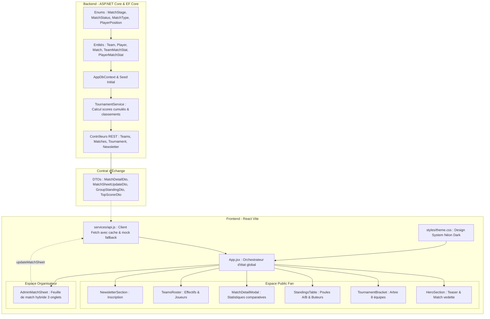

# 🧠 AI Documentation Hub - PhyGital Soccer

Ce dossier sert de mémoire technique, de journal de bord chronologique et de cartographie des interdépendances pour le développement assisté par IA du projet **PhyGital Soccer**.

Chaque évolution, ajout de composant, modification de schéma de données ou ajustement d'API doit être documenté ici afin de préserver l'intégrité architecturale et la cohérence inter-modules.

---

## 🗺️ 1. Cartographie des Interdépendances (Architecture Globale)

Le projet repose sur une chaîne d'interdépendance stricte entre la base de données, l'API REST et les interfaces utilisateurs :

---

## 🔗 2. Matrice d'Impact & Dépendances par Couche

| Élément modifié | Impact direct | Composants Frontend dépendants | Points de vigilance |
| :--- | :--- | :--- | :--- |
| **`Models/Match.cs`** | `AppDbContext`, `DbInitializer`, `TournamentService`, `MatchDtos` | `MatchCard`, `MatchDetailModal`, `AdminMatchSheet` | Gestion des scores cumulés (Physique + Virtuel) et égalité |
| **`Enums/MatchType.cs`** | `TeamMatchStat`, `PlayerMatchStat`, `GlobalUsings.cs` | `api.js`, `AdminMatchSheet`, `MatchDetailModal` | Éviter le conflit avec `System.IO.MatchType` via `GlobalUsings.cs` |
| **`TeamMatchStat.cs`** | `MatchesController/UpdateMatchSheet`, `TournamentService` | `AdminMatchSheet` (Onglets 1 & 2), `MatchDetailModal` | Calcul de possession (doit totaliser 100%) et tirs cadrés $\le$ tirs totaux |
| **`Penalty Shootouts`** | `Match.Team1Penalties`, `Match.Team2Penalties` | `TournamentBracket`, `AdminMatchSheet` (Onglet 3) | Condition de déverrouillage : seulement si score cumulé à égalité |
| **`styles/theme.css`** | Tous les composants visuels | Tous (`Navbar`, `HeroSection`, `MatchCard`, etc.) | Respect des tokens de couleurs néon (Rose `#FF007F`, Cyan `#00E5FF`) |

---

## 📜 3. Historique Chronologique des Modifications

| Index | Date & Heure | Titre / Phase | Périmètre | Documentation détaillée |
| :---: | :---: | :--- | :--- | :--- |
| **#001** | 2026-09-10 12:05 | Initialisation Globale & Moteur Hybride | Backend ASP.NET, Frontend React, Enums, Modèles, Correction conflit MatchType | [001_initial_setup_and_architecture.md](file:///Users/ndongmo/Documents/code/PhyGitalSoccer/ai/changelogs/001_initial_setup_and_architecture.md) |
| **#002** | 2026-09-10 12:35 | Refonte Design Professionnel | Design System, Typography (Barlow), Theme Tokens, 13 composants UI mis à jour | [002_design_refactor_professional.md](file:///Users/ndongmo/Documents/code/PhyGitalSoccer/ai/changelogs/002_design_refactor_professional.md) |
| **#003** | 2026-09-10 12:40 | Intégration Vidéo Teaser & Vignette | Assets statiques (`teaser.mp4`, `teaser-thumbnail.jpg`), HeroSection modal player | [003_teaser_video_integration.md](file:///Users/ndongmo/Documents/code/PhyGitalSoccer/ai/changelogs/003_teaser_video_integration.md) |
| **#004** | 2026-09-10 12:50 | Dashboard Admin & Restructuration du Site | Portail Admin sécurisé PIN (1234), Onglets Équipes, Joueurs, Photos & Médias, Site Public | [004_admin_dashboard_and_restructuring.md](file:///Users/ndongmo/Documents/code/PhyGitalSoccer/ai/changelogs/004_admin_dashboard_and_restructuring.md) |

---

## ⚙️ 4. Règles de Travail pour les Futures Évolutions

1. **Avant toute modification** :
   - Consulter la matrice d'impact ci-dessus.
   - Identifier si la modification touche un DTO, un modèle ou une logique partagée entre les deux univers (Gazon et Virtuel).
2. **Après chaque modification** :
   - Valider la compilation backend (`dotnet build backend/PhyGitalSoccer.Api/PhyGitalSoccer.Api.csproj`).
   - Valider le build frontend (`npm run build` dans `frontend/`).
   - Ajouter une entrée chronologique dans `ai/changelogs/XXX_nom_etape.md` et mettre à jour la table ci-dessus.
