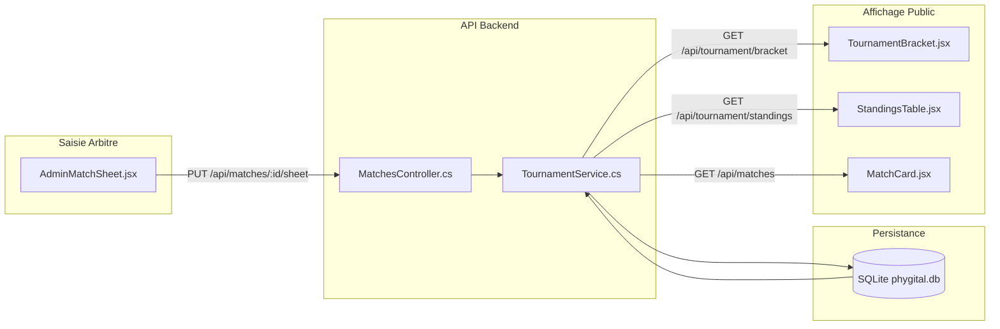

# Changelog #001 - Initialisation Globale & Architecture Hybride

- **Date** : 2026-09-10
- **Auteur** : Antigravity (AI Assistant)
- **Objectif** : Structuration initiale complète du projet PhyGital Soccer (Backend ASP.NET Core EF Core + Frontend React Vite) selon les spécifications de `REAMDE.MD`.

---

## 1. Contexte & Besoins Utilisateur

Le projet PhyGital Soccer est une compétition novatrice opposant 8 équipes sur deux manches :
1. **Manche 1 (Gazon physique)** : soccer à 4/5 joueurs sur terrain réel.
2. **Manche 2 (Console virtuelle / FIFA)** : e-sport avec les mêmes formations.
3. **Score Cumulé** : La somme des buts physiques et virtuels désigne le vainqueur. En cas d'égalité stricte, une séance de tirs au but départage les équipes.

---

## 2. Fichiers Créés & Modifiés

### 🔹 Backend (`backend/PhyGitalSoccer.Api/`)
- **Projet & Solution** :
  - `PhyGitalSoccer.slnx` : Solution .NET 10.
  - `PhyGitalSoccer.Api.csproj` : Web API avec paquets `Microsoft.EntityFrameworkCore.Sqlite` et `Microsoft.EntityFrameworkCore.Design`.
- **Enums (`Enums/`)** :
  - `PlayerPosition.cs` : Gardien, Défenseur, Milieu, Attaquant.
  - `MatchStage.cs` : GroupA, GroupB, SemiFinal, ThirdPlace, Final.
  - `MatchStatus.cs` : Scheduled, InProgress, Completed.
  - `MatchType.cs` : Physical, Digital.
- **Modèles de Données (`Models/`)** :
  - `Team.cs` : Équipe, nom, logo, poule (A ou B), couleur néon, liste des joueurs.
  - `Player.cs` : Nom, photo, numéro, poste terrain.
  - `Match.cs` : Équipe 1, Équipe 2, phase, statut, date, score tirs au but conditionnels.
  - `TeamMatchStat.cs` : Statistiques collectives scindées par `MatchType` (possession, tirs, corners, fautes, cartons).
  - `PlayerMatchStat.cs` : Statistiques individuelles scindées par `MatchType` (buts, passes, cartons).
  - `NewsletterSubscriber.cs` : Inscriptions newsletter.
- **Accès aux Données (`Data/`)** :
  - `AppDbContext.cs` : Définition des clés étrangères, restrictions de suppression en cascade pour éviter les cycles entre `Team1` et `Team2`.
  - `DbInitializer.cs` : Seed des 8 franchises officielles (Poule A & Poule B) et premier match avec résultats physique + virtuel.
- **Logique Métier & DTOs** :
  - `DTOs/MatchDtos.cs` : Contrats JSON (`MatchDetailDto`, `MatchSheetUpdateDto`, `GroupStandingDto`, `TopScorerDto`).
  - `Services/TournamentService.cs` : Moteur de calcul du score cumulé, calcul dynamique des classements des poules A et B, détection de l'égalité et qualification des demi-finales.
- **Contrôleurs REST (`Controllers/`)** :
  - `TeamsController.cs` : CRUD des équipes et de leur roster.
  - `MatchesController.cs` : Consultation et mise à jour de la feuille de match avancée (`PUT /api/matches/{id}/sheet`).
  - `TournamentController.cs` : Endpoints pour le classement, les meilleurs buteurs et l'arbre de tournoi.
  - `NewsletterController.cs` : Souscription courriel.
- **Configuration** :
  - `Program.cs` : Configuration SQLite, CORS (`localhost:5173`), `JsonStringEnumConverter`, initialisation automatique de la base.
  - `GlobalUsings.cs` : Résolution d'ambiguïté (voir section 3).

### 🔹 Frontend (`frontend/`)
- **Setup & Packages** :
  - Projet React 19 + Vite 8.
  - Paquet d'icônes sport/e-sport : `lucide-react`.
  - Polices Google Fonts : `Outfit` et `Rajdhani`.
- **Design System** (`src/styles/theme.css`) :
  - Fond sombre spatial néon (`#070913`).
  - Accents Rose PhyGital (`#FF007F`) et Cyan E-Sport (`#00E5FF`).
  - Badges, cartes glassmorphism, transitions et bordures luminescentes.
- **Composants d'interface (`src/components/`)** :
  - `Navbar.jsx` : En-tête officiel avec logo canadien, navigation par onglets et CTA.
  - `HeroSection.jsx` : Présentation du concept hybride (inspiré de *Phygital Games of the Future*) et carte du dernier résultat.
  - `MatchCard.jsx` : Affichage synthétique des scores cumulés `[Gazon | Console | Total]`.
  - `TournamentBracket.jsx` : Visualisation de l'arbre du tournoi (8 équipes, 2 poules, demi-finales croisées et finale).
  - `StandingsTable.jsx` : Tableau complet des classements avec ventilation des buts physiques et virtuels + classement individuel des buteurs.
  - `TeamsRoster.jsx` : Présentation des 8 équipes participantes et effectifs d'athlètes.
  - `AdminMatchSheet.jsx` : **Feuille de match avancée** organisée en 3 onglets (Physique, Virtuel, Tirs au but déverrouillés uniquement en cas d'égalité).
  - `MatchDetailModal.jsx` : Popup analytique détaillée pour décortiquer une confrontation.
  - `NewsletterSection.jsx` & `Footer.jsx` : Engagement spectateurs et mentions légales.
- **Couche Données & Services** (`src/services/api.js`) :
  - Fonctions fetch connectées à l'API ASP.NET Core avec données de secours (fallback) pour permettre une utilisation déconnectée immédiate.

---

## 3. Incident Résolu : Conflit de Nommage `MatchType`

### Symptôme
Lors de la première compilation du backend, 4 erreurs `CS0104` sont survenues :
```
error CS0104: 'MatchType' is an ambiguous reference between 'PhyGitalSoccer.Api.Enums.MatchType' and 'System.IO.MatchType'
```

### Cause Racine
Les templates .NET 10 activent `<ImplicitUsings>enable</ImplicitUsings>`. Cela inclut implicitement `System.IO`, qui expose une énumération interne `System.IO.MatchType` (`Win32` ou `Simple`). Le compilateur ne pouvait donc pas trancher automatiquement avec `PhyGitalSoccer.Api.Enums.MatchType`.

### Solution Déployée
Création du fichier `backend/PhyGitalSoccer.Api/GlobalUsings.cs` :
```csharp
global using MatchType = PhyGitalSoccer.Api.Enums.MatchType;
```
Cette directive globale préempte la résolution dans l'ensemble du projet sans nécessiter d'alias verbeux dans chaque fichier source.

---

## 4. Interdépendances Établies



---

## 5. Statut de Validation
- Backend : `dotnet build` $\rightarrow$ **0 avertissement, 0 erreur**.
- Frontend : `npm run build` $\rightarrow$ **Succès (360ms)**.
