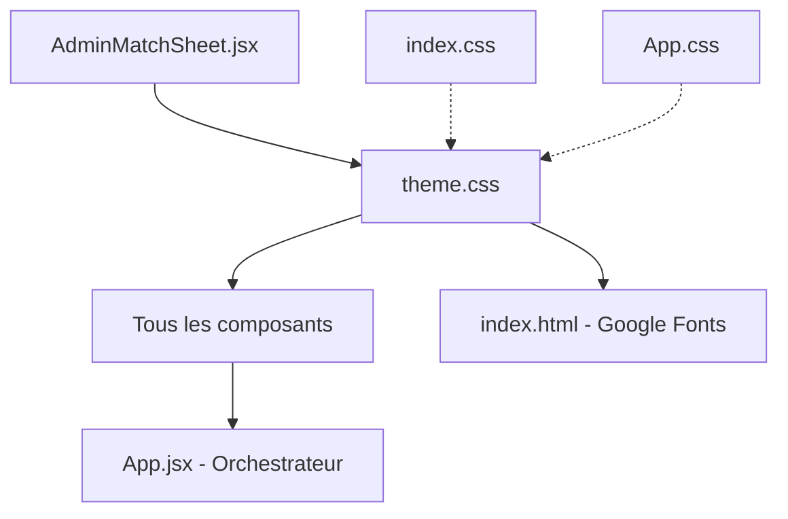

# 002 — Refonte Design : Style Professionnel Classique

**Date** : 2026-09-10  
**Auteur** : AI Assistant  
**Référence** : GoFuture Games (gofuture.games/disciplines/item/phygital-football/)

## Résumé

Refonte complète du design frontend, passant du style neon/cyber (glassmorphism, glows roses/cyan, gradients colorés) vers un design **professionnel, classique et sportif** inspiré du site officiel des Games of the Future.

## Changements

### Design System (`styles/theme.css`)
- **Palette** : Remplacement des couleurs neon (`#FF007F`, `#00E5FF`) par des couleurs sobres (`#e8155c`, `#3b82f6`)
- **Fond** : Dégradé bleu marine profond subtil (`#080d1a → #0e1530`) au lieu de radial-gradients colorés
- **Typographie** : Ajout de `Barlow Condensed` (sportif/condensed) pour les titres, `Outfit` conservé pour le corps
- **Cards** : Classe `.card` avec fond solide (`#111827`) au lieu de `.glass-panel` avec backdrop-filter
- **Boutons** : `.btn-primary` (fond solide), `.btn-secondary`, `.btn-outline` — sans box-shadow glow
- **Badges** : Couleurs désaturées, bordures fines
- **Suppression** : `.gradient-text-*`, `.glow-border-*`, `.glass-panel`, `.btn-cyan`, `--shadow-neon-*`
- **Ajout** : `.section-label`, `.section-title` pour structurer les en-têtes de section

### Polices (`index.html`)
- Remplacement de `Rajdhani` par `Barlow Condensed` (italic + condensed = style sportif professionnel)
- Conservation de `Outfit` pour le corps du texte

### Composants modifiés

| Composant | Changements principaux |
|---|---|
| `Navbar.jsx` | Pills arrondies (GoFuture style), fond solide, pas de glow sur le logo |
| `HeroSection.jsx` | Breadcrumb simple, titre italic bold uppercase, pas de glow ambient |
| `MatchCard.jsx` | `.card` au lieu de `.glass-panel`, scores sobres |
| `MatchDetailModal.jsx` | Fond solide, tabs avec souligné fin, barres de stats bicolores |
| `StandingsTable.jsx` | `.section-label`/`.section-title`, table sobre |
| `TeamsRoster.jsx` | Cards avec bordure-top colorée, badges simplifiés |
| `TournamentBracket.jsx` | Cartes solides avec bordures colorées, finale dorée sobre |
| `NewsletterSection.jsx` | Card sobre avec bordure-top primary, pas de radial-gradient |
| `Footer.jsx` | Fond très sombre, hover sur les liens |
| `App.jsx` | Sections avec `section-label`/`section-title`, maxWidth 1200px |
| `AdminMatchSheet.jsx` | Migration des tokens CSS (sed search-replace) |

### CSS nettoyés
- `index.css` : Vidé (design dans theme.css)
- `App.css` : Vidé (restes du template Vite supprimés)

## Mapping des tokens CSS

| Ancien token | Nouveau token |
|---|---|
| `--bg-dark` | `--bg-body` |
| `--bg-card` (rgba) | `--bg-card` (solid) |
| `--primary-pink` | `--color-primary` |
| `--primary-cyan` | `--color-secondary` |
| `--accent-green` | `--color-success` |
| `--accent-gold` | `--color-warning` |
| `--accent-purple` | `--color-accent` |
| `--text-main` | `--text-primary` |
| `--text-muted` | `--text-secondary` |
| `--text-dim` | `--text-muted` |
| `.glass-panel` | `.card` |
| `.btn-cyan` | `.btn-secondary` |
| `.gradient-text-*` | `<em>` ou `style={{ color }}` |
| `.glow-border-*` | `borderTop: 3px solid` |

## Dépendances

## Fichiers impactés (13)

1. `frontend/src/styles/theme.css`
2. `frontend/index.html`
3. `frontend/src/components/Navbar.jsx`
4. `frontend/src/components/HeroSection.jsx`
5. `frontend/src/components/MatchCard.jsx`
6. `frontend/src/components/MatchDetailModal.jsx`
7. `frontend/src/components/StandingsTable.jsx`
8. `frontend/src/components/TeamsRoster.jsx`
9. `frontend/src/components/TournamentBracket.jsx`
10. `frontend/src/components/NewsletterSection.jsx`
11. `frontend/src/components/Footer.jsx`
12. `frontend/src/App.jsx`
13. `frontend/src/components/AdminMatchSheet.jsx`
