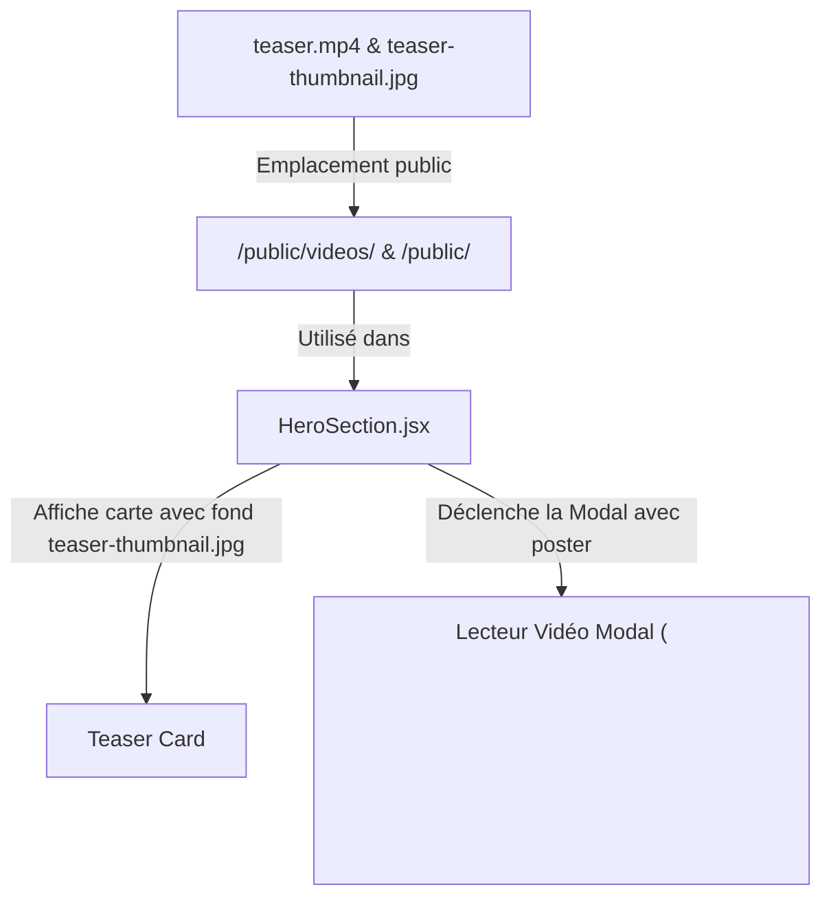

# Changelog 003 — Intégration de la Vidéo Teaser & Vignette Personnalisée

**Date** : 10 Septembre 2026  
**Auteur** : Antigravity AI  

---

## 1. Description du Changement
- Intégration du fichier vidéo teaser fourni par l'utilisateur (`teaser.mp4`) dans le dossier public static (`/public/videos/teaser.mp4`).
- Remplacement de l'ancienne vignette/arrière-plan par une nouvelle vignette sur-mesure (`teaser-thumbnail.jpg`) illustrant la fusion du terrain physique et de l'arène esports (couleurs bleu marine et magenta).
- Mise en place d'un lecteur vidéo modal interactif accessible depuis la section Hero avec poster/vignette dédiée.

---

## 2. Emplacement et Organisation des Fichiers

| Fichier / Dossier | Action | Description |
| :--- | :--- | :--- |
| `frontend/public/videos/teaser.mp4` | **[CRÉÉ]** | Emplacement public pour la vidéo teaser |
| `frontend/public/teaser-thumbnail.jpg` | **[CRÉÉ]** | Nouvelle vignette dynamique (concept physique + virtuel) |
| `frontend/src/components/HeroSection.jsx` | **[MODIFIÉ]** | Arrière-plan de la carte mis à jour + attribut `poster` sur le lecteur modal |
| `ai/changelogs/003_teaser_video_integration.md` | **[MIS À JOUR]** | Documentation des modifications |

---

## 3. Dépendances et Interdépendances

