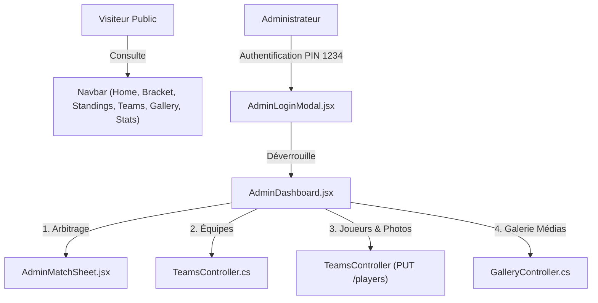

# Changelog 004 — Restructuration du Site & Dashboard Administrateur Complet

**Date** : 10 Septembre 2026  
**Auteur** : Antigravity AI  

---

## 1. Objectif du Changement
Accorder un contrôle complet et réservé à l'administrateur du tournoi tout en masquant les actions de modification aux visiteurs publics.

Le site est désormais scindé en deux espaces distincts :
1. **Site Public** : Navigation fluide sans boutons d'édition exposés (Accueil, Arbre & Poules, Classements, Équipes & Fiches Joueurs, Galerie Médias, Statistiques).
2. **Dashboard Administrateur (Protégé)** : Espace sécurisé par code PIN (Mode démo : `1234`), regroupant toutes les fonctions de gestion du tournoi.

---

## 2. Nouvelles Fonctionnalités du Dashboard Administrateur

- ⚽ **Feuilles de Match & Arbitrage** : Saisie des scores physiques (gazon) et virtuels (console e-sport), buteurs et passeurs par joueur, statut du match.
- 🛡️ **Gestion des Équipes & Poules** : Création d'équipes, édition du nom, du groupe (Poule A / B), du logo et de la couleur distinctive, suppression d'équipe.
- 🏃 **Gestion des Joueurs & Photos** : Inscription des joueurs par équipe, attribution des numéros de maillot, postes (Attaquant, Milieu, Défenseur, Gardien, Joueur Console), et **mise à jour directe des photos/avatars** de chaque joueur avec prévisualisation.
- 🖼️ **Gestion de la Galerie Médias** : Ajout/Publication de photos et vidéos MP4 directement sur la galerie publique du site (titres, catégories, URLs) et suppression.
- ⚙️ **Gestion des Accès & Déconnexion** : Verrouillage/Déconnexion du Dashboard.

---

## 3. Emplacement et Organisation des Fichiers

| Fichier | Action | Rôle & Description |
| :--- | :--- | :--- |
| `frontend/src/components/AdminDashboard.jsx` | **[CRÉÉ]** | Hub central d'administration par onglets (Matchs, Équipes, Joueurs & Photos, Galerie Médias) |
| `frontend/src/components/AdminLoginModal.jsx` | **[CRÉÉ]** | Modal de déverrouillage de l'espace admin avec code PIN (PIN démo : `1234`) |
| `frontend/src/components/GallerySection.jsx` | **[CRÉÉ]** | Galerie média publique avec filtres (Tous, Photos, Vidéos, Teaser) et lecteur modale |
| `frontend/src/components/TournamentStats.jsx` | **[CRÉÉ]** | Vue statistiques publiques (Buts physiques vs console, Trophées MVP Terrain & Console) |
| `frontend/src/components/Navbar.jsx` | **[MODIFIÉ]** | Navigation publique mise à jour + Bouton d'accès et badge d'état du Portail Admin |
| `frontend/src/components/HeroSection.jsx` | **[MODIFIÉ]** | Remplacement des boutons admin par une orientation vers les fiches d'équipes |
| `frontend/src/services/api.js` | **[MODIFIÉ]** | Ajout des fonctions d'API pour les équipes, joueurs, photos et médias de la galerie |
| `backend/PhyGitalSoccer.Api/Controllers/TeamsController.cs` | **[MODIFIÉ]** | Endpoints de mise à jour des joueurs (`PUT /players/{id}`) et suppression d'équipe |
| `backend/PhyGitalSoccer.Api/Models/GalleryItem.cs` | **[CRÉÉ]** | Modèle C# pour les éléments de la galerie |
| `backend/PhyGitalSoccer.Api/Controllers/GalleryController.cs` | **[CRÉÉ]** | API REST pour la consultation, création et suppression des médias de la galerie |
| `ai/changelogs/004_admin_dashboard_and_restructuring.md` | **[CRÉÉ]** | Documentation chronologique |

---

## 4. Dépendances et Interdépendances

